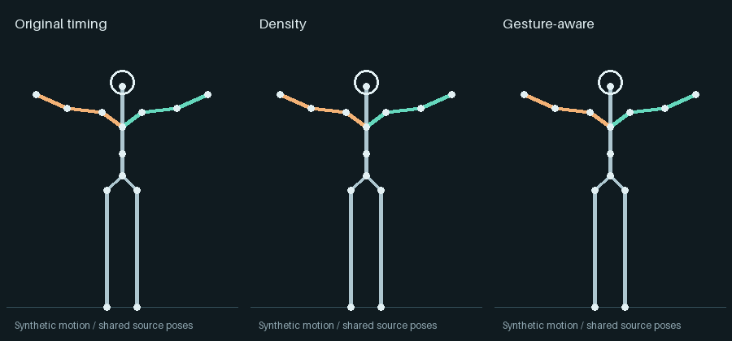

<div align="center">

# CHARM

### Character-aware Holds and Adaptive Rhythm for Motion

Pose-preserving retiming and controlled pose experiments for stylized character animation.

[Quick start](#quick-start) · [Methods](docs/METHODS.md) · [New characters](docs/NEW_CHARACTER.md) · [Research credits](docs/REFERENCES.md)

</div>



CHARM takes **already-retargeted character motion** and lets you compare timing treatments while keeping complete source poses together. It also provides bounded curve cleanup and protected-joint mixing for pose sources already aligned to the target rig.

This is an experimental toolkit, not an official implementation of the papers cited below. The preview is an original procedural skeleton example, not captured motion or a third-party character. Visual preference on a new action still needs review.

## Quick start

Python 3.10+; NumPy and SciPy. Run from this checkout:

```bash
python -m pip install -e .
python scripts/demo.py --output runs/demo
python -m unittest discover -s tests
```

The CPU-only demo generates and verifies **eight variants** from the bundled synthetic motion. It requires no Blender, trained weights, video-model account or GPU. Choose a new output folder on subsequent runs; existing results are not overwritten.

The installed CLI is `charm`; `motionkit` and `python -m motionkit` are compatibility entry points.

```bash
charm run --input examples/synthetic/input.npz \
  --config examples/synthetic/rig.json \
  --events examples/synthetic/events.json \
  --output runs/my_comparison
```

On Windows PowerShell, put the command on one line or use PowerShell's continuation character.

## What is included

| Approach | What changes |
|---|---|
| Original | Nothing; identity control |
| Uniform twos | Regular two-frame pose updates |
| Density timing | More time around low-displacement poses; faster transitions, bounded by fixed anchors |
| Adaptive holds | Selective short holds near anchors |
| Curve cleanup | Bounded SO(3) simplification of explicitly selected local rotation curves |
| Gesture-aware timing | Small, constrained edits around verified gesture exits |
| Protected pose mixing | Strength/cap control for an already-aligned target-rig pose source |

Timing uses one shared whole-body time map. It samples the accepted root, limbs and fingers together. Pose edits preserve every unselected local transform and check configured world-protected joints. Preserving local fingers is not a promise of collision-free hands.

## Bring your own character

1. Export accepted character animation to the [canonical NPZ format](docs/DATA_FORMAT.md), using the optional Blender adapter or your own exporter.
2. Generate and review a rig config: fps, world-up axis, units, semantic roles and protected joints.
3. Compare original and density first. Add gesture events only after verifying their actual frame windows on that clip.
4. Bake/render candidates with identical camera, materials and lighting. Keep the original as a control.

See [the complete workflow](docs/NEW_CHARACTER.md). Rig names, hierarchy order, frame count and fps are configurable. New gesture event files are bound to a motion fingerprint, so frame numbers from one clip cannot silently be applied to another.

CHARM does not include video-to-motion tracking, automatic retargeting, new skinning, cloth physics or a learned motion-style generator. A target-aligned external style clip can be mixed through the API; STyMo itself remains an upstream project.

## Research credit

- **Tame–Tsume:** Tomohiko Mukai, Hayato Okonogi, and Akinobu Maejima, *Pose-Density-Based Motion Retiming for Anime-Style Tame-Tsume* (2026). [Author page](https://mukai-lab.org/publications/sa2026techcomm-tame-tsume/) · [DOI](https://doi.org/10.1145/3829339.3847839). CHARM uses a simplified positive inverse-density dwell map with fixed duration/anchors, not the complete published method.
- **MoNACA:** Yui Koroku and Issei Fujishiro, *MoNACA: A System for Anime-like Motion Transfer by Adaptive Partitioning of Articular Trajectories* (2024). [Paper](https://doi.org/10.3756/artsci.23.6_1). Our curve/hold experiments are limited adaptations, not the full system.
- **STyMo:** Jose Luis Ponton, Alexander Winkler, Ladislav Kavan, Yuting Ye, and Petr Kadlecek, *STyMo: Fast and Controllable Few-Shot Motion Style Transfer* (2026). [Official code](https://github.com/facebookresearch/STyMo) · [DOI](https://doi.org/10.1145/3811356). CHARM includes a generic aligned-pose mixer, not STyMo code, training data or weights.

See [references and contribution boundaries](docs/REFERENCES.md). Please cite the original research when building on its methods, as well as CHARM when using this implementation. Software citation metadata is provided in [CITATION.cff](CITATION.cff).

## Reproducibility and limitations

Tests cover hierarchy roundtrips, different fps/length/bone names, units, protected transforms, timing invariants, event fingerprints and CLI behavior. A CI template is included in `ci/tests.workflow.yml`; enable it by copying it to `.github/workflows/tests.yml` with an account/token allowed to publish workflows. See [VALIDATION.md](docs/VALIDATION.md).

Timing changes velocities and dynamics, even when poses stay exact. Automatic anchors are geometric proposals, not semantic understanding or music beats. Video-model descriptions may help propose events, but need independent frame verification; no model API is required by CHARM.

Private production assets, recordings, paper PDFs, checkpoints and machine-specific research archives are intentionally absent. Everything in the public synthetic example is generated by its included source.

## Development credits

Created and directed by **leacvikas0**, with AI-assisted development by **GPT Sol 6.1 (OpenAI Codex)** across implementation, experiment design, verification, and documentation. Additional assistance included DeepSeek Harness for interface/rendering work and Gemini for video-analysis proposals checked against motion data. These development credits are separate from the original research citations above.

## License

[MIT](LICENSE) for CHARM's code, documentation and original synthetic example. Upstream papers, projects, datasets and weights retain their own terms and are linked rather than redistributed here.

